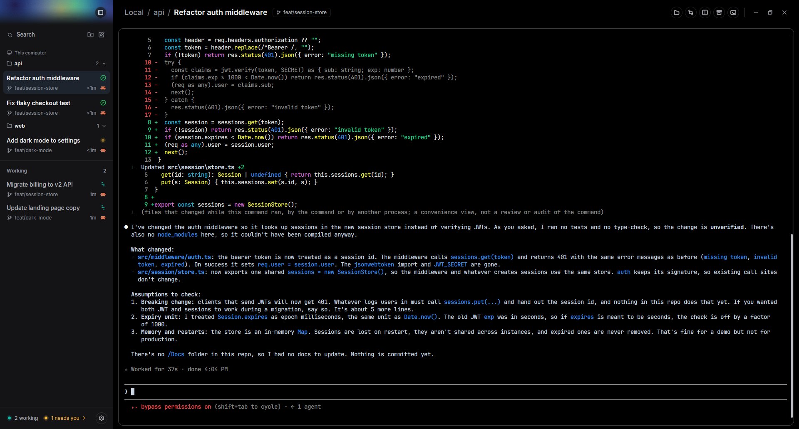

# Zerdr

**A threads layout for [Herdr](https://herdr.dev).** Every tab is a thread. The sidebar shows the agents working right now as cards and groups the rest by machine and project, with one marker per state everywhere (teal spinner = working, amber dot = needs you, check = done). A gradient at the top tells you how everything is going at a glance: drifting while anything works, still when nothing does, amber when something needs you. The terminal sits alone in a quiet rounded card.

## Install

Ask your Herdr agent to add `herdr.dev/layouts/rezonnnnn/zerdr`.

By hand:

1. Copy `layouts/Zerdr.json`, `layouts/Zerdr.png` and every `mods/zerdr-*` folder into `~/.config/herdr-app/` (or `$HERDR_APP_HOME`).
2. Merge the `layout:Zerdr` section of `keys.json` into your `keys.json`.
3. Run `herdr-app do layout.switch '{"name":"Zerdr"}'`, or pick Zerdr in Settings. `Ctrl+Shift+L` cycles back to your other layouts.

## Keys (in this layout)

| Key | Does |
|---|---|
| `Ctrl+Shift+T` | New thread: pick an agent and a project (`Alt+W` = own git worktree) |
| `Ctrl+Shift+B` | Collapse / expand the sidebar |
| `Ctrl+Tab` / `Ctrl+Shift+Tab` (`Alt+]` / `Alt+[`) | Next / previous thread |
| `F2` | Rename thread (Herdr's own key) |

## What it runs

Nothing reaches the network. The mods run local programs only where the thread is:

- `zerdr-sidebar`: `hc read` on agent terminals, to count background shells.
- `zerdr-files`: read-only `git` plus `sh` or PowerShell, to list folders.
- `zerdr-changes`: `git status`/`diff`, plus `add`/`rm`/`commit` when you ask.

Web links in Markdown previews open in your browser. [RECIPE.md](RECIPE.md) has the full build brief.

## Credits

- [Inter](https://rsms.me/inter/) by Rasmus Andersson, SIL Open Font License 1.1 (see `mods/zerdr-sidebar/fonts/LICENSE-Inter.txt`).

## License

MIT for the layout and mods. Inter keeps its own licence.
