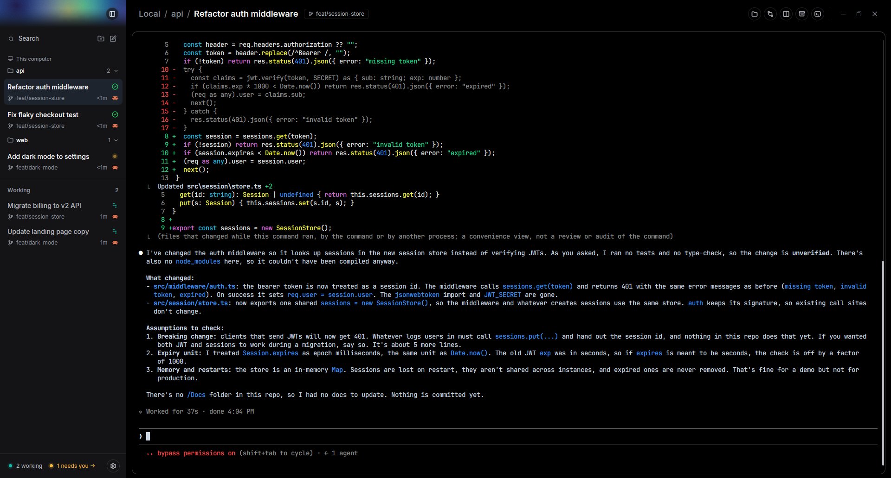

# Zerdr

A threads layout for Herdr. Every tab is a thread. A left sidebar lists threads by machine and project, the agents working right now get their own cards, and a slim header names the thread you are in. A mesh gradient at the top of the sidebar reflects how all your threads are doing at a glance: drifting while anything works, still and dimmed when nothing does, amber when a thread needs you. The terminal sits alone in a rounded card on black.

## What you see

Left to right: a 272 px sidebar (`chrome` `#141416`, not draggable), then the work column on `canvas` black. No system title bar.

**Sidebar, top to bottom**

| Block | Size | Shows |
|---|---|---|
| Header (`zerdr-viz`) | 60 px, window drag | Mesh gradient: five soft blobs (blue, indigo, teal, violet, black at 55%) drifting over `#2a5fb0`, with grain on top. 2 px chrome bands fade it into the sidebar from 18 px down. One 28 px round frosted toggle (chrome at 60%, 1 px `#FFFFFF1F` ring, `panel-left` icon), vertically centred, 16 px from the right |
| Threads (`zerdr-sidebar`) | starts at 200 px, min 60 | Search field with New project (folder-plus) and New thread (square-pen) buttons. Then the threads not working, in groups: machine ("This computer" first, then remotes by name) › project (folder icon, name, thread count, fold chevron) › thread rows. A folded project shows the needs-you marker on its header when a thread inside needs you. Each row is 56 px, two lines: the title (14 px; semibold until opened), the time worked in `dim` and the agent harness's logo (its name as the tooltip, or the name when it has no logo); below it, the git branch (branch icon, 12 px `dim`) on the left and the state marker (see Status markers) on the right, so markers sit on the bottom line as on the Working cards. Machine and project are not repeated on the row; the headers say them. The marker is full strength until you open the thread, then fades over 1.2 s to 50% and stays. Archived threads go in a folded "Archived" section at the bottom |
| Working (`zerdr-agents` part `list`) | starts at 150 px, min 60, sizes itself to its rows | "Working N" heading, then one card per thread with a busy agent. Each card is a thread row (56 px): title, time worked and harness logo on top; branch on the left and the spinner on the right below. Machine and project are in the card's tooltip. Working cards recede: the title is `muted` (medium weight), while the spinner stays full `working` teal. The shown thread's card fills `selected` `#1d242d` and its title is `foreground`. Sub-agents are listed under their thread, indented 22 px on an elbow connector, with their own marker on the left |
| Fill | flex | empty |
| Footer (`zerdr-agents` part `footer`) | 53 px | One line: status dot with halo plus "N working", an amber "N needs you →" link that jumps to that thread (only when there is one), then the settings button. Short labels so all three fit 272 px |

**Work column**

- **Header (`zerdr-header`), 60 px, window drag:** a breadcrumb `machine / project / thread` (thread title semibold `foreground`, the rest `dim`), then a branch chip (branch icon + branch, or the worktree folder name), centred on the title. On the right are five 28 px round icon buttons (Files, Changes, Split, Archive, Commands), a divider, and the window buttons (minimise, maximise, close) where the system draws none.
- **Body:** padding 8 / 12 px, gap 12 px. The active tab's panes are drawn as cards: radius 12, 1 px `#ffffff14` border, `#ffffff3d` when focused, 8 px gap, framed even when alone. Terminal padding is 14 / 12 px.
- **Right panel, 340 px (280–900), hidden by default:** a stack with Files (`zerdr-files`: a lazy file browser with read-only previews and rendered Markdown) and Changes (`zerdr-changes`: git diff with stage and commit). Both are drawn as the same card as the panes (radius 12, `#ffffff14` border). The Files path field shows the path's tail at rest (`…\code\project`) and the full path while you edit it; a status line shows only when the folder is pinned or the path is wrong.

**Look:** base theme `ink`, with these overrides: `chrome #141416`, `canvas #000000`, `raised #151a21`, `selected #1d242d`, `border #23262c`, `foreground #eeeeef`, `muted #b4b7bd`, `dim #8a8f98`, `accent #3b82f6`, `working #14b8a6`, `blocked #f5b83d`, `done #22c55e`, `idle #6e6e73`. The UI font is Inter (bundled in `mods/zerdr-sidebar/fonts/`, SIL OFL).

## How it behaves

- **Status markers** are the same in every list, rail and footer, and shape always backs colour: working = teal braille spinner (10 frames, 80 ms; no frame fills a dot column, so it never reads as a kebab menu); waiting on sub-agents or background shells = the same spinner; needs you = amber dot in a soft amber halo; done = `circle-check` in `done`; idle = 9 px hollow ring. Teal means working and nothing else; accent blue marks selection and open panels.
- **Gradient header** follows all your threads together. While any thread works the blobs drift at full strength; when none does they hold still at 35% (1.2 s fade); an amber layer fades in (1.2 s) when any thread needs you. It uses native loops and transitions only, no timers.
- **Sidebar toggle** (button or `Ctrl+Shift+B`) collapses the sidebar to a 44 px rail (76 px on macOS) that keeps the toggle and the status markers. The content slides out its full width to the left (200 ms, ease-in), the sidebar resizes once (so the terminal reflows once), and on expand the content slides back in (260 ms, ease-out). The offset sits on an inner element: Herdr ignores `left` on a mod's root. The last width is remembered.
- **Search** filters both lists: the sidebar shares the query as `threads.q` and the Working list applies it too.
- **Thread rows and cards:** click focuses the thread. Hovering a thread row lays Rename (F2) and Archive over its right end on the `raised` fill, so the title never re-truncates; Working cards have no hover actions (archive a working thread from the header). Archive settles the tab, and opening an archived thread brings it back (Unarchive on hover too). `Ctrl+Tab` / `Ctrl+Shift+Tab` and `Alt+]` / `Alt+[` step through threads. New rows slide in from above, and the selected row gets a short 2 px accent stamp on its left edge.
- **Time worked** adds up each thread's working runs (stored per machine in the mod's localStorage and shared as `threads.worked`). A thread that has never worked shows no time; its tooltip says "Not started".
- **New thread** (`Ctrl+Shift+T` or square-pen) opens a 540×400 dialog with an agent rail on the left (detected installed agents) and project search on the right. Tab / Shift+Tab switch sides, arrows pick, Enter starts, `Alt+W` gives the thread its own git worktree (via the shipped `worktree` mod), Esc clears then closes. The agent you last started with is the default. Start (like Create and Commit) is the one primary style: solid `solid` fill, radius 8, raised and dim when it can't run.
- **New project** (folder-plus) opens a 340×236 dialog on `chrome`, as New thread: a name and/or a folder, then Create (`space.new`). The project is saved (shared `projects`), so it stays listed after its space closes.
- **Header buttons:** Files and Changes toggle the right panel and its tab, Split splits the pane, Archive settles the thread, and Commands opens the palette. Clicking the thread title renames it.

## Built from

- `layouts/Zerdr.json`: root row → `sidebar` column [`viz` block (`zerdr-viz`, 60 px) · `threads` (`zerdr-sidebar`, 200 px) · `agents` (`zerdr-agents` `{part:"list"}`, 150 px) · `sidebar-fill` (weight 1) · `sidebar-foot` (`zerdr-agents` `{part:"footer"}`, 53 px)], `work` column [`header` (`zerdr-header`, 60 px) · `work-body` row [`main` (active tab, pane cards) · `panel` column (hidden) → `panel-body` stack [`files` (`zerdr-files`) · `changes` (`zerdr-changes`)]]].
- Overlays: `zerdr-new-thread`, `zerdr-new-project`, plus the shipped `worktree`.
- `keys.json` (section `layout:Zerdr`): `ctrl-shift-t` `mod.open:zerdr-new-thread`, `ctrl-shift-b` `zerdr-viz.toggle`, `ctrl-tab`/`alt-]` `zerdr-sidebar.next`, `ctrl-shift-tab`/`alt-[` `zerdr-sidebar.prev`.
- Shipped Herdr icons used by path: `mods/workspace-chrome/*.svg` (archive, check, chevrons, circle-check, folder, folder-plus, monitor, panel-left, search, server, settings, square-pen, x), `mods/pane/close.svg`, `mods/tabs/win-min.svg`, `win-max.svg`, `win-restore.svg`, `win-close.svg`. No mod may name an icon outside this list: anything else renders blank on a stock install.
- Commands: `layout.resize`, `layout.show`/`hide`/`select`, `tab.select`/`rename`/`settle`/`unsettle`, `tab.new`, `space.new`, `space.select`, `agent.focus`, `terminal.peek`, `pane.split`, `app.palette`, `app.settings`, `window.*`.
- Shared keys: `sidebar.width`, `sidebar.collapsed`, `sidebar.phase` (the same ones `workspace-chrome` uses), `threads.worked`, `threads.q` (the search query, cleared on start), `threads.bg` (background shells per agent terminal), `projects`.
- `press.js` is the same file in four mods (press feedback for buttons), because mods can't import from each other.

## Watch out

- **Programs it runs**, all where the thread is (on its machine):
  - `zerdr-sidebar` runs `hc read` on agent terminals to spot background shells.
  - `zerdr-files` runs `git rev-parse` / `git status` (`--no-optional-locks`, fsmonitor off) and `sh` or PowerShell to list folders.
  - `zerdr-changes` runs `git status` / `diff`, plus `git add` / `rm` / `commit` when you stage or commit.
  - Clicking a web link in a Markdown preview opens it in your browser (`rundll32` / `open` / `xdg-open`).
  - Nothing else leaves the machine; no mod makes network requests.
- The sidebar is not draggable (`resizable: false`). Width changes go through the toggle, which resizes to 44/76 px and back to the remembered width.
- The gradient's fade is drawn as 2 px chrome bands, not an image, because Herdr keeps image aspect ratios. The bands use the theme's `chrome`, so change the colour there and the fade follows.
- The header height (60) matches `zerdr-header`'s height, so the toggle centres on the header's icon row. Change both together.
- `projects.seed.js` (in `zerdr-new-thread`) is empty. Add `{ name, folder }` entries there to pre-fill projects on first run.

## Done when

- `herdr-app check` passes for each of the eight `mods/zerdr-*` folders.
- `herdr-app do layout.switch '{"name":"Zerdr"}'` succeeds and `herdr-app status` shows `"layout": "Zerdr"` with no errors.
- A `herdr-app shot` matches `preview.png`: a 60 px gradient header with the toggle level with the header's icon buttons, threads grouped by machine and project in two-line rows (logo top right, branch and marker below), working cards in the same two-line layout, a one-line footer with nothing clipped at 272 px, and the terminal in a rounded card.
- `herdr-app do mod.open '{"name":"zerdr-new-thread"}'` lists `zerdr-new-thread` under `overlays`.
- `herdr-app do zerdr-viz.toggle` collapses the sidebar to the rail, and running it again restores the width.
